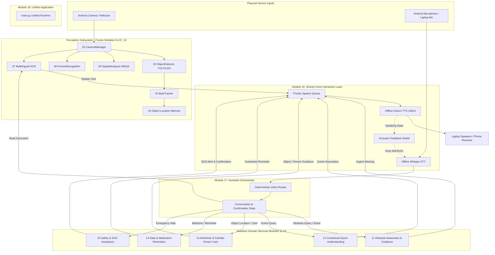

# NAYRA — Final Modular Voice-First Architecture
**Document:** `NAYRA_FINAL_ARCHITECTURE.md`  
**System Version:** NAYRA MVP 1.0  
**Date:** 2026-11-23  

---

## 1. System Architecture Overview

NAYRA is structured into four functional layers:
1. **Perception & Sensing Layer (Modules 01–07, 10):** Camera acquisition, object detection, tracking, depth estimation, face recognition, OCR, and spatial object memory.
2. **Assistive Domain Services Layer (Modules 11–15):** Obstacle awareness, scene understanding, Alzheimer's care, daily reminders, and emergency SOS.
3. **Shared Voice & Interaction Layer (Module 16):** Offline Whisper speech recognition, offline Kokoro speech synthesis, centralized priority speech queue, and acoustic feedback shielding.
4. **Orchestration & Application Layer (Modules 17–18):** Central deterministic intent router, domain dispatch, dialog state management, and unified startup application (`main.py`).



---

## 2. Directory Layout & Module Organization

```text
NAYRA/
│
├── 01_camera_input/          # [Frozen] Threaded HTTP MJPEG & OpenCV capture
├── 02_camera_manager/        # [Frozen] Camera facade and status telemetry
├── 03_object_detection/      # [Frozen] YOLOv10n ONNX object detection
├── 04_object_tracking/       # [Frozen] ByteTrack multi-object tracker
├── 05_spatial_awareness/     # [Frozen] Monocular depth estimation & proximity
├── 06_person_recognition/    # [Frozen] Consent-based face recognition & context DB
├── 07_ocr/                   # [Frozen] Multilingual text detection & recognition
├── 08_tts/                   # [Frozen] Kokoro offline speech synthesis & audio player
├── 09_voice/                 # [Frozen] Whisper speech recognition & VAD
├── 10_object_memory/         # [Active] Object location memory & spatial indexing
│
├── 11_obstacle_awareness/    # [New] Directional hazard guidance & spoken warnings
├── 12_scene_understanding/   # [New] Natural scene description & spatial layout
├── 13_alzheimer_assistance/  # [New] Familiar person assist, cognitive care & history
├── 14_daily_assistance/      # [New] Medication scheduling & routine reminders
├── 15_safety_sos/            # [New] Voice-triggered SOS & emergency workflows
│
├── 16_voice_interaction/     # [New] Unified shared voice layer & priority queue
├── 17_assistant_orchestrator/# [New] Central deterministic intent router & dispatcher
├── 18_application/           # [New] Application lifecycle & runtime coordinator
│
├── shared/                   # [New] Standardized system contracts
│   ├── interfaces/           # Base abstract interfaces (IVoiceService, IAssistiveModule, etc.)
│   ├── events/               # Event bus dataclasses (ObstacleEvent, ReminderEvent, etc.)
│   ├── schemas/              # Common dataclasses (SpeechRequest, IntentResult, etc.)
│   ├── exceptions/           # Unified domain exceptions
│   └── utilities/            # Thread-safe primitives & audio math
│
├── config/                   # Central application & module settings
├── data/                     # Local SQLite databases, memory snapshots & profiles
├── models/                   # Pretrained ONNX weight files (local-first)
├── tests/                    # System-wide test suites
├── main.py                   # Primary application entrypoint
├── requirements.txt          # Production dependencies
└── README.md                 # Complete documentation
```

---

## 3. Communication Contracts & Interfaces

To eliminate circular dependencies and mutable global state, all modules communicate via `shared`:
- **`shared.schemas.SpeechPriority`**:
  1. `CRITICAL_SAFETY` (SOS events, immediate collision stop warnings)
  2. `EMERGENCY_INTERACTION` (SOS confirmation prompts and cancellation)
  3. `OBSTACLE_WARNING` (Directional obstacles: left, center, right)
  4. `USER_QUERY_RESPONSE` (Direct responses to user inquiries)
  5. `REMINDER` (Medication and schedule notifications)
  6. `INFORMATIONAL` (Scene descriptions, background tips)

- **`shared.interfaces.IVoiceOutput`**:
  Exposes `speak(text: str, language: str, priority: SpeechPriority, block: bool) -> bool`, `stop()`, and `is_speaking()`.

- **`shared.interfaces.IAssistiveModule`**:
  Standard interface implemented by Modules 10–15:
  - `initialize() -> bool`
  - `process_query(query: IntentRequest) -> IntentResponse`
  - `shutdown() -> None`

---

## 4. Concurrency & Concurrency Guarantees

1. **Camera Ingestion Worker:** Native 30 FPS capture thread writing to a 1-frame atomic buffer.
2. **Vision Perception Worker:** Runs at ~5–10 FPS, executing YOLO, ByteTrack, and depth analysis off the UI thread.
3. **Voice Audio Listener:** Continuous streaming thread performing Voice Activity Detection (VAD). Utterances are emitted on silence completion.
4. **Speech Output Worker:** Dedicated thread draining the `PrioritySpeechQueue` into Kokoro TTS and PortAudio.
5. **Scheduled Reminder Worker:** Lightweight 1 Hz background timer monitoring the SQLite reminder database for trigger events.
