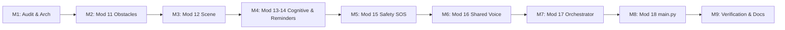

# NAYRA — Complete MVP Implementation Roadmap
**Document:** `NAYRA_IMPLEMENTATION_ROADMAP.md`  
**Execution Plan:** Milestones 1 through 9  
**Target:** Unified Voice-First Assistive AI Companion  
**Date:** 2026-11-23  

---

## Roadmap Overview

---

## Detailed Milestone Execution Sequence

### Milestone 1: Repository Audit & Architecture (Completed)
- Produce `NAYRA_COMPLETE_PROJECT_AUDIT.md`, `NAYRA_FINAL_ARCHITECTURE.md`, `NAYRA_IMPLEMENTATION_ROADMAP.md`.
- Establish `shared/` package (interfaces, schemas, events, exceptions).

### Milestone 2: Module 11 — Obstacle Awareness & Direction Guidance
- Reuse Module 03 (YOLO), Module 04 (ByteTrack), and Module 05 (Spatial Depth & Zoning).
- Classify obstacle hazards (physical furniture, doors, persons in path vs small tabletop items).
- Estimate relative proximity and horizontal zones (left, ahead, right).
- Generate concise bilingual spoken warnings with repetition suppression (hysteresis cooldown).
- Deliver unit tests in `11_obstacle_awareness/tests/`.

### Milestone 3: Module 12 — Contextual Scene Understanding
- Interpret object detections, tracks, spatial relationships, and OCR text into a coherent scene summary.
- Support voice queries: *"Mere saamne kya hai?"*, *"Describe my surroundings"*, *"Mere right side mein kya hai?"*.
- Ground all output strictly in verified perception data; no hallucinated environmental details.
- Deliver unit tests in `12_scene_understanding/tests/`.

### Milestone 4: Modules 13–14 — Cognitive & Daily Assistance
- **Module 13 (Alzheimer's Assistance):** Extend Module 10 object memory; integrate Module 06 familiar person identification for queries like *"Ye kaun hai?"* or *"Who is in front of me?"*; maintain caregiver notes.
- **Module 14 (Daily Assistance & Reminders):** Persistent SQLite reminder database (`data/reminders.db`); voice creation (*"NAYRA, 8 baje medicine yaad dilana"*); recurring schedules, repeat, snooze, and dismiss.
- Deliver unit tests in `13_alzheimer_assistance/tests/` and `14_daily_assistance/tests/`.

### Milestone 5: Module 15 — Safety & SOS Assistance
- Voice-triggered emergency assistance: *"NAYRA, emergency help chahiye"*.
- Strict 2-step confirmation and cancellation workflow to prevent accidental dispatches.
- Configurable emergency contacts store (`data/emergency_contacts.json`).
- Structured emergency alert payload generation (GPS timestamp, last seen scene, contact phone numbers).
- Deliver unit tests in `15_safety_sos/tests/`.

### Milestone 6: Module 16 — Shared Voice Interaction Layer
- Unify Whisper STT (Module 09) and Kokoro TTS (Module 08) into a single system-wide voice server.
- Priority-based speech queue: Critical Safety > SOS > Obstacle Warning > User Response > Reminder > Info.
- Acoustic Feedback Shield: discard microphone input during active TTS playback + 1.2s post-speech cooldown.
- Non-blocking asynchronous speech synthesis and playback.
- Deliver unit tests in `16_voice_interaction/tests/`.

### Milestone 7: Module 17 — NAYRA Assistant Orchestrator
- Deterministic local intent router combining regex patterns, semantic token matching, and domain dispatch.
- Routes spoken queries to Modules 07 (Read Aloud), 10 (Object Memory), 11 (Obstacles), 12 (Scene), 13 (Alzheimer's & People), 14 (Reminders), and 15 (SOS).
- Handles dialog state (clarification questions, confirmation prompts for SOS/deletion).
- Deliver unit tests in `17_assistant_orchestrator/tests/`.

### Milestone 8: Module 18 & Unified `main.py`
- Complete `18_application/` runtime coordinator.
- Unified single command: `python main.py` boots all subsystems in topological order.
- Supports headless voice mode or optional OpenCV preview window with HUD.
- Clean shutdown handler (`Ctrl+C` flushes databases, stops workers, releases audio/camera).

### Milestone 9: Full Automated Verification & Documentation
- Stage A Unit Tests across all modules.
- Stage B Cross-module integration tests.
- Stage C Full voice-query routing tests in Hindi, Hinglish, and English.
- Deliver complete user manuals, architecture specifications, API references, and implementation reports.
