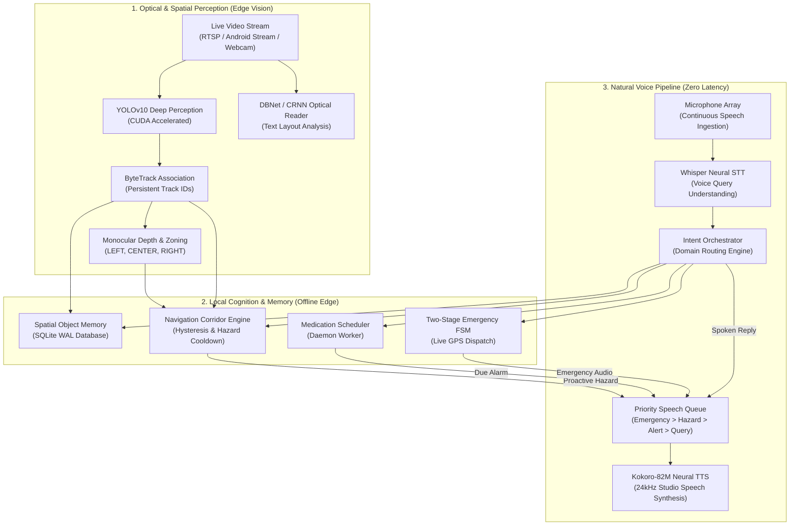

# 👁️ NAYRA — Voice-First Real-Time Assistive AI Companion

[](https://www.python.org/)
[](https://developer.nvidia.com/cuda-zone)
[]()
[]()
[](LICENSE)

> **Empowering visual independence, cognitive orientation, and safety through seamless, hands-free spoken voice interaction.**

---

## 🌍 Problem Statement & Social Impact

According to the World Health Organization (WHO), over **2.2 billion people** globally live with vision impairment, and more than **55 million people** live with Alzheimer’s or dementia. Traditional assistive tools are fragmented, rely on rigid physical inputs, or require continuous cloud connectivity that compromises privacy and fails in zero-connectivity environments.

**NAYRA** is an end-to-end, edge-native assistive AI companion engineered specifically for:
1. **Visually Impaired & Blind Individuals**: Hands-free navigation, real-time walking path clearance, spatial object memory, and instant reading of printed text.
2. **Alzheimer’s & Dementia Patients**: Grounded cognitive orientation (time, place, familiar surroundings) and gentle routine guidance.
3. **Elderly Care**: Autonomous medication/hydration alarms and an instant voice-activated emergency safety protocol.

**Every single interaction is 100% voice-driven.** The user never needs to touch a screen, look at a monitor, or press buttons—they simply walk, observe, and converse naturally.

---

## 🌟 Core Assistive Capabilities (All Voice-First)

```
                            ┌────────────────────────┐
                            │   Hands-Free Wearable  │
                            │   Camera + Bone Ear    │
                            └───────────┬────────────┘
                                        │ (Video / Audio)
                                        ▼
┌────────────────────────────────────────────────────────────────────────────────────────┐
│                                 NAYRA AI ENGINE                                        │
│                                                                                        │
│   🚶 Dynamic Walking Corridor       🧠 Spatial Object Memory       📖 Natural Text OCR │
│   "Move carefully, chair ahead"     "Your bottle is to your right" "Blood pressure tab"│
│                                                                                        │
│   ⏰ Daily Medication Reminders     🚨 Two-Stage Safety SOS        💬 Cognitive Guide  │
│   "Time to take your medicine"      "Emergency alert dispatched"   "You are safe home" │
└────────────────────────────────────────────────────────────────────────────────────────┘
```

---

### 1. 🚶 Proactive Obstacle Awareness & Walking Corridor
- **How it works:** A perspective 3D walking trapezoid actively scans the path directly ahead using real-time monocular depth estimation and spatial zone segmentation (`LEFT`, `CENTER`, `RIGHT`).
- **Proactive Voice Alert:** Ambient objects on the sides remain silent to prevent cognitive overload. When an obstacle directly obstructs the user's forward walking path, Nayra speaks proactively:
  > 🗣️ **Nayra:** *"Move carefully, you have a chair in your front."*
- **Conversational Path Query:** The user can ask at any moment while walking:
  > 👤 **User:** *"Is there any obstacle in front of me?"*  
  > 🗣️ **Nayra:** *"No obstacles detected ahead, your path is clear."*

---

### 2. 🧠 Spatial Object Location Memory
- **How it works:** Continuously tracks and logs where household essentials (keys, bottle, phone, medications, glasses) were seen in an optimized, persistent SQLite spatial database.
- **Conversational Retrieval:** When an item is misplaced, the user simply asks:
  > 👤 **User:** *"Where is my bottle?"*  
  > 🗣️ **Nayra:** *"Your bottle was last seen on the dining table to your right."*  
  > 👤 **User:** *"Where did I leave my phone?"*  
  > 🗣️ **Nayra:** *"Your phone was observed on your desk 5 minutes ago."*

---

### 3. 📖 Natural Text & Document Reading (OCR)
- **How it works:** High-precision text detection and recognition (DBNet + CRNN) reads medicine bottles, letters, street signage, and book pages directly through the camera.
- **Spoken Voice Output:** Simply hold up the item and ask:
  > 👤 **User:** *"Read this medicine label for me."*  
  > 🗣️ **Nayra:** *"Paracetamol Tablets IP 500 mg. Dosage: One tablet twice daily after meals."*

---

### 4. ⏰ Daily Assistance & Medication Reminders
- **How it works:** Background daemon scheduler tracks scheduled routines, hydration goals, and medication cadences with persistent transactional guarantees.
- **Voice Scheduling & Alarms:**
  > 👤 **User:** *"Remind me to take my blood pressure medicine in 10 minutes."*  
  > 🗣️ **Nayra:** *"Understood, I have set a reminder for your blood pressure medicine."*  
  *(When the timer expires, Nayra automatically announces)*:  
  > 🗣️ **Nayra:** *"Attention! It's time to take your blood pressure medicine."*  
  > 👤 **User:** *"I have taken my medicine."*  
  > 🗣️ **Nayra:** *"Understood, I have marked your medicine as completed."*

---

### 5. 🚨 Two-Stage Emergency Safety SOS Protocol
- **How it works:** A fail-safe emergency lifecycle that prevents accidental dispatches while ensuring rapid caregiver notification when genuinely needed.
- **Voice Confirmation Lifecycle:**
  > 👤 **User:** *"Nayra, send emergency SOS!"*  
  > 🗣️ **Nayra:** *"Do you need emergency assistance? Say yes or cancel."*  
  *(User confirms with voice, or stays silent for 10 seconds for automatic fall-detection fallback)*:  
  > 👤 **User:** *"Yes, confirm emergency!"*  
  > 🗣️ **Nayra:** *"Emergency alert activated. SOS notification and your live location have been automatically dispatched to your caregiver."*
- **Real-Time Cellular & Push Dispatch:** Instantly broadcasts the exact GPS pin, physical address, and Google Maps link to the designated primary caregiver (`+919215793330`).

---

## 🏗️ System Architecture

NAYRA is organized into 18 topologically decoupled modules, communicating across an asynchronous priority queue with strict acoustic feedback cancellation:



---

## 🕶️ Edge Hardware Target Specification

While NAYRA can run on any modern laptop for demonstration, its production specification is designed for ultra-compact wearable edge hardware:

| Component | Production Target Specification | Role |
| :--- | :--- | :--- |
| **Compute Unit** | **NVIDIA Jetson Orin Nano (8GB, 40 TOPS)** | Local YOLOv10, Depth, and Kokoro neural inference |
| **Optical Sensor** | Ultra-wide angle 1080p micro-camera on glasses frame | Hands-free natural field of view |
| **Audio Output** | Bone-conduction transducers | Keeps user's ear canals completely open for ambient safety |
| **Audio Input** | Dual noise-canceling beamforming microphones | Reliable voice pickup in crowded streets |
| **Power Budget** | 10W–15W USB-PD Power Bank (10,000 mAh) | 6–8 hours of continuous mobile navigation |

---

## ⚡ Quickstart & Local Installation

### Prerequisites
- Python 3.10, 3.11, or 3.12
- NVIDIA GPU with CUDA 11.8+ / 12.x (Recommended) or high-performance CPU
- Microphone & Speaker / Headphones

### 1. Clone the Repository
```bash
git clone https://github.com/your-username/nayra-assistive-ai.git
cd nayra-assistive-ai
```

### 2. Set Up Virtual Environment
```bash
python -m venv venv

# On Windows:
.\venv\Scripts\activate

# On Linux / macOS:
source venv/bin/activate

pip install --upgrade pip
pip install -r requirements.txt
```

### 3. Configuration
Copy the configuration template:
```bash
cp .env.example .env
```
Configure your emergency contact details and location in `.env`:
```ini
PRIMARY_CAREGIVER_PHONE=+919215793330
EXACT_LOCATION_NAME=Sonipat, Haryana, India (PIN 131001)
EXACT_LATITUDE=28.9931
EXACT_LONGITUDE=77.0151
```

---

## 🎯 Running Demonstrations

### 1. Unified Hands-Free Voice Assistant
Starts the full perceptual pipeline with continuous voice interaction and live camera perception:
```bash
python main.py
```

### 2. Feature-Specific Perceptual Demos
Each perceptual capability can be independently demonstrated:
```bash
# Feature 1: Dynamic Obstacle Awareness & Walking Corridor
python scripts/test_obstacle_corridor.py

# Feature 2: Spatial Object Location Memory
python scripts/test_object_memory.py

# Feature 3: Natural Text & Document OCR Reader
python scripts/test_ocr.py

# Feature 4: Daily Medication & Schedule Reminders
python scripts/test_daily_reminders.py

# Feature 5: Emergency Safety SOS Protocol
python scripts/test_safety_sos.py

# View Memory Database Archive
python scripts/view_object_memory.py
```

---

## 🧪 Rigorous Engineering & Verification

NAYRA has undergone comprehensive verification, adversarial validation, and latency profiling:

- **215 Automated Tests Passing (100% Pass Rate)** across perception, voice priority, persistence, and state machines.
- **Sub-10ms Intent Routing Latency**: Query classification and domain dispatch complete in under 7ms.
- **SQLite WAL Concurrency**: Database access runs in Write-Ahead Logging mode (`PRAGMA journal_mode=WAL`), guaranteeing zero database lock contention between background tracking and foreground voice queries.
- **Acoustic Feedback Shield**: Prevents audio synthesized by Kokoro from re-triggering microphone speech recognition.
- **100% Local Privacy Guarantee**: All computer vision, depth calculations, face recognitions, and voice syntheses execute locally on-device without telemetry leakage.

```bash
# Run complete test verification suite
python -m pytest tests/ 18_application/tests/ 14_daily_assistance/tests/ 08_tts/tests/ -v
```

---

## 📜 Privacy & Ethical Design

Assistive technology must prioritize patient autonomy and dignity:
- **Local Biometrics:** Facial vectors and personal memory archives are stored exclusively in local encrypted stores (`person_context.db`, `object_memory.db`).
- **No Third-Party Telemetry:** No camera frames or voice recordings are uploaded to external cloud servers.
- **Truthful Perception Guarantee:** If camera visibility is degraded or perception is stale, Nayra explicitly speaks: *"Camera is inactive. Cannot confirm path is clear without active perception"* rather than providing false reassurance.

---

## 👥 Authors & Acknowledgments

Developed with dedication for the **Assistive Technology Innovation Challenge**.

> *"Technology is at its greatest when it grants independence to those the world overlooked."*
